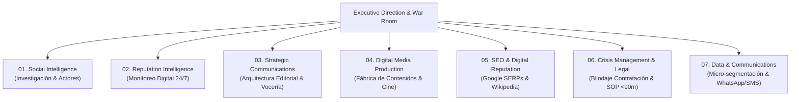
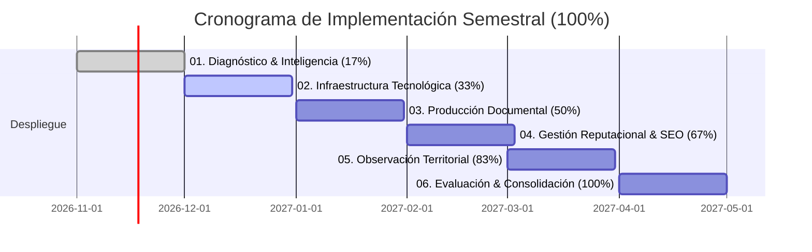
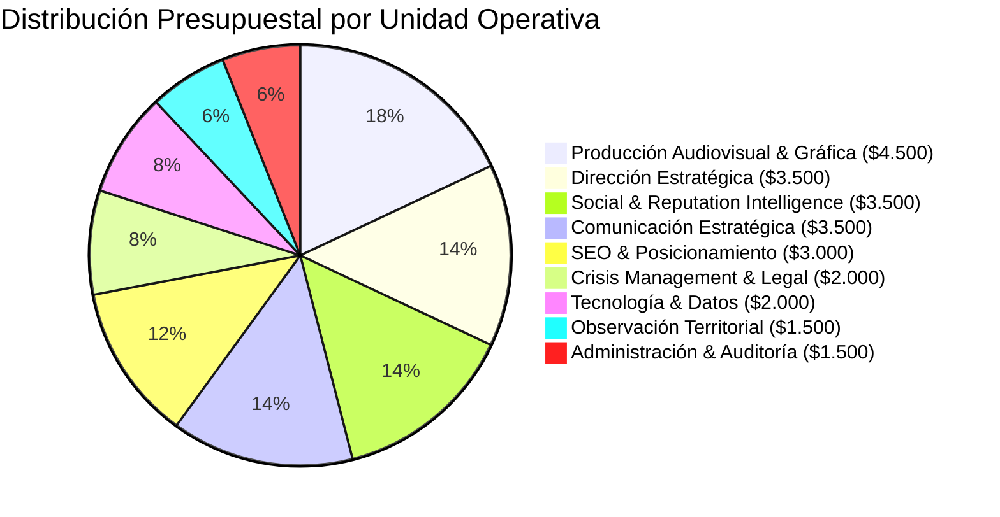

# INGENIERÍA SOCIAL · SOCIAL INTELLIGENCE & STRATEGIC MANAGEMENT
## Plataforma de Inteligencia y Gestión Reputacional · Executive Proposal
### Candidatura de Wilmer Yair Castellanos Hernández — Gobernación de Boyacá

---

### Resumen Ejecutivo

| Parámetro | Valor Verificado |
| :--- | :--- |
| **Cliente Estratégico** | Wilmer Yair Castellanos Hernández / Gobernación de Boyacá 2028–2031 |
| **Objeto de Consultoría** | Plataforma de Inteligencia Social, Gestión Reputacional, Fábrica de Contenidos Multimedia y Blindaje Jurídico-Crisis |
| **Modelo Operativo** | Consultoría estratégica de ingeniería social con formato y tablero SaaS centralizado |
| **Inversión Mensual** | **USD $25.000** (Tarifa plana todo incluido) ≈ **$100.000.000 COP** (TRM ref. $4.000) |
| **Modalidad del Contrato** | **Retainer Mensual Recurrente** (Auditable por entregables) |
| **Inversión Mensual Plana** | **USD $25.000 / mes** ≈ **$100.000.000 COP / mes** |
| **Unidades de Servicio** | **7 Módulos Operativos Especializados** |
| **Monitoreo & Cobertura** | Observatorio digital permanente **24/7**, 123 municipios, 13 provincias |

---

## 1. Arquitectura del Servicio (7 Módulos Operativos)

La consultoría opera como un ecosistema cohesionado bajo dirección unificada, evitando la dispersión de contratistas aislados y garantizando sincronía total:

### Módulo 01: Social Intelligence (Investigación Territorial)
- **Propósito:** Análisis documental sistemático, observación social en los 123 municipios boyacenses, mapeo continuo de actores institucionales (alcaldes, concejales, diputados, líderes comunales JAC) y seguimiento de coyunturas de asuntos públicos.
- **Entregable:** 4 Informes Semanales de Inteligencia Política (24 semestrales) con matrices de actores por provincia.
- **SLA:** Entrega fija cada lunes a las 8:00 AM.

### Módulo 02: Reputation Intelligence (Monitoreo & Radar)
- **Propósito:** Observatorio digital 24/7 y escucha activa de medios departamentales (radio regional, prensa escrita, portales web), redes sociales (X, TikTok, Instagram, Facebook) y foros locales para detectar tendencias y desinformaciones.
- **Entregable:** Matriz permanente de riesgos, alertas tempranas de incidentes (<15 min) y dossier mensual de reputación.
- **SLA:** Régimen continuo ininterrumpido 24/7.

### Módulo 03: Strategic Communications (Arquitectura Editorial)
- **Propósito:** Definición de la línea discursiva "El Ingeniero de Soluciones Reales", comunicados de prensa con sustento técnico y gestión de entrevistas y vocerías oficiales.
- **Entregable:** 4 Entrevistas de fondo mensuales en medios de comunicación (24 semestrales), boletines oficiales y minutas de debate.
- **SLA:** Respuesta y vocería editorial diaria.

### Módulo 04: Digital Media Production (Fábrica de Contenidos)
- **Propósito:** Producción audiovisual con cámaras 4K y drones en corredores viales y municipios, fotografía de alta resolución, edición de cápsulas verticales y diseño infográfico.
- **Entregable:** 12 Videos cortos verticales al mes (72 semestrales), 12 Piezas gráficas/infografías al mes (72 semestrales) y 2 Minidocumentales de impacto territorial bimensuales (12 semestrales).
- **SLA:** Publicaciones pautadas mínimo 3 veces por semana.

### Módulo 05: SEO & Digital Reputation (Posicionamiento en Buscadores)
- **Propósito:** Dominio absoluto de los resultados de búsqueda de Google (SERP #1 a #10) para Wilmer Castellanos, optimización de Knowledge Panel, Wikipedia/Wikidata y canalización legítima de solicitudes de actualización ante notas descontextualizadas.
- **Entregable:** Auditoría técnica SEO mensual, indexación de portales oficiales y presencia en primera página.
- **SLA:** Optimización y monitoreo semanal de indexación.

### Módulo 06: Crisis Management & Legal Shield (Protección y Blindaje)
- **Propósito:** Protocolo estandarizado de respuesta inmediata y blindaje jurídico ante controversias contractuales históricas (Sutamarchán, Invías, contratación pública). Asesoría jurídica de juristas sénior en derecho electoral y disciplinario.
- **Entregable:** Repositorio digital probatorio de certificados SECOP, actas de liquidación, derechos de petición y solicitudes de rectificación.
- **SLA:** Triage en 15 minutos, argumentario probatorio desplegado en menos de 90 minutos.

### Módulo 07: Data & Communications Management (Tecnología & Red Veredal)
- **Propósito:** Gestión y segmentación de bases de datos de contactos autorizados, canales directos vía SMS informativos y Red de WhatsApp Veredal en las 13 provincias, con estricto apego a Habeas Data.
- **Entregable:** Automatización de flujos de difusión, reportes de analítica de entrega y micro-segmentación geográfica.
- **SLA:** Disponibilidad tecnológica 99.9% y actualización semanal.

---

## 2. Roadmap de Implementación (6 Fases / 6 Meses)

El despliegue sigue una curva escalonada y acumulativa de madurez estratégica:

| Hito | Fase | Avance | Alcance & Entregables Críticos |
| :---: | :--- | :---: | :--- |
| **01** | **Diagnóstico e inteligencia** | **17%** | Auditoría integral del histórico de Wilmer Castellanos, investigación documental de contratación, mapeo de los 123 municipios y matriz FODA de riesgos. |
| **02** | **Infraestructura tecnológica** | **33%** | Verificación de canales digitales oficiales, configuración del observatorio digital 24/7 y protocolos de reacción rápida. |
| **03** | **Producción documental** | **50%** | Rodaje en territorio boyacense, archivo audiovisual de infraestructura vial, testimonios campesinos y biblioteca de contenidos. |
| **04** | **Gestión reputacional** | **67%** | Despliegue de posicionamiento SEO en Google, monitoreo intensivo de controversias y contención activa de guerra sucia. |
| **05** | **Observación territorial** | **83%** | Activación de red directa SMS y WhatsApp veredal en 13 provincias y seguimiento a compromisos adquiridos en giras. |
| **06** | **Evaluación y consolidación** | **100%** | Auditoría final de impacto, informe de balance semestral, liquidación satisfactoria y plan de continuidad hacia los comicios. |

---

## 3. Dashboard de Indicadores (KPIs Mensuales y Semestrales)

| Indicador Clave de Rendimiento | Meta Mensual | Total Acumulado (6 Meses) | Modalidad & SLA |
| :--- | :---: | :---: | :--- |
| **Informes de inteligencia** | **4** | **24** | Semanal fijo (Lunes 8:00 AM) |
| **Videos cortos (Reels/TikTok/Shorts)** | **12** | **72** | 3 piezas por semana |
| **Piezas gráficas de alto nivel** | **12** | **72** | 3 infografías/piezas semanales |
| **Entrevistas & vocerías en medios** | **4** | **24** | 1 vocería estratégica semanal |
| **Minidocumentales de territorio** | **2** | **12** | Quincenal (impacto vial y agro) |
| **Informe ejecutivo directivo** | **1** | **6** | Mensual integral para el candidato |
| **Monitoreo de incidentes & crisis** | **Permanente** | **24/7 Continuo** | Reacción probatoria < 90 min |

---

## 4. Inversión y Distribución Presupuestal

### Presupuesto Mensual: USD $25.000 (≈ $100.000.000 COP)
### Modelo: Retainer Mensual Recurrente contra Entrega de Resultados

| Unidad Operativa de Servicio | Asignación Mensual (USD) | Asignación Mensual (COP ref.) | Total 6 Meses (USD) | Participación |
| :--- | :---: | :---: | :---: | :---: |
| **Producción Audiovisual & Gráfica** | $4.500 | $18.000.000 | $27.000 | 18,0% |
| **Dirección Estratégica General** | $3.500 | $14.000.000 | $21.000 | 14,0% |
| **Social & Reputation Intelligence** | $3.500 | $14.000.000 | $21.000 | 14,0% |
| **Comunicación Estratégica & Relato** | $3.500 | $14.000.000 | $21.000 | 14,0% |
| **SEO & Posicionamiento en Buscadores** | $3.000 | $12.000.000 | $18.000 | 12,0% |
| **Crisis Management & Soporte Jurídico** | $2.000 | $8.000.000 | $12.000 | 8,0% |
| **Tecnología, Datos y Mensajería SMS** | $2.000 | $8.000.000 | $12.000 | 8,0% |
| **Observación & Despliegue Territorial** | $1.500 | $6.000.000 | $9.000 | 6,0% |
| **Administración, Auditoría & Soporte** | $1.500 | $6.000.000 | $9.000 | 6,0% |
| **TOTAL OPERACIÓN MENSUAL** | **$25.000 USD** | **$100.000.000 COP** | **$150.000 USD** | **100,0%** |

---

## 5. Estructura del Equipo Directivo (7 Perfiles C-Level)

1. **Executive Director:** Liderazgo general de la consultoría, interlocución con Wilmer Castellanos, supervisión de entregables y trazabilidad financiera.
2. **Social Intelligence Director:** Coordinación de la investigación territorial, mapas de actores institucionales y dinámica del censo electoral boyacense.
3. **Reputation Intelligence Analyst:** Operación del observatorio digital 24/7, monitoreo en tiempo real de medios y detección de alertas tempranas.
4. **Strategic Communications Director:** Arquitectura editorial del relato "El Ingeniero de Soluciones", gestión de prensa y preparación de vocerías.
5. **Creative & Media Director:** Dirección de realizadores audiovisuales en territorio, fotografía, posproducción y piezas infográficas.
6. **Digital Operations Manager:** Optimización SEO en Google, administración de servidores y micro-segmentación de canales directos.
7. **Legal & Compliance Advisor:** Blindaje probatorio de contratación (SECOP), régimen disciplinario, derechos de rectificación y protección jurídica.

---

## 6. Modelo de Gobierno, Supervisión y Código Ético

### Mecanismos de Control Institucional
- **Tablero de Control SaaS 24/7:** Visualización permanente de cumplimiento y avance de indicadores.
- **Comités Semanales de 60 minutos:** Sincronización entre el director ejecutivo de la consultoría y el candidato o su comité.
- **Aprobación Previa Obligatoria:** Ningún contenido se hace público sin visto bueno expreso del cliente.
- **Desembolso contra Entregables:** Facturación y pago mensual condicionado a actas de recibo a satisfacción.

### Manifiesto Ético (White-Hat Social Intelligence)
La operación se rige por un compromiso deontológico irrestricto:
- **Cero Granja de Bots:** Prohibición absoluta del uso de cuentas automatizadas o identidades simuladas.
- **Cero Guerra Sucia:** La consultoría no crea ni propaga falsedades ni manipula la opinión pública.
- **Cumplimiento Legal Total:** Observancia estricta de la Ley 1581 de 2012 (Habeas Data) y lineamientos del CNE.
- **Contratación Pública Transparente:** La defensa reputacional se fundamenta con documentos oficiales y probatorios del SECOP.
